# 🌿 Git Branch Map

Git Branch Map turns a busy local repository's branch list into a compact overview: which branches are checked out, which track a remote, and what changed most recently.

## 📌 The problem

As branches accumulate, it becomes easy to forget their upstreams or purpose. A quick branch map helps with housekeeping before merging or deleting anything.

## ✨ Features

- List local branches with current-branch marker.
- Show upstream and ahead/behind tracking text when available.
- Show last commit date and subject.
- Read-only by design: it never deletes, checks out, or pushes branches.
- Works in any directory inside a Git repository.

## 🧩 Design and architecture

The script delegates Git metadata collection to git for-each-ref using a stable field format, then renders the returned records. Git remains the source of truth; no repository files are changed.

### 📌 Project structure

~~~text
gitbranch-map/
|-- README.md
|-- gitbranch_map.py
~~~

The starter implementation is intentionally small. Extend it in focused steps and keep the documented behavior aligned with the code.

## ⚙️ Requirements and setup

Requires Python 3.9+ and Git on PATH. Save gitbranch_map.py and run it from inside a Git working tree.

## 🚀 Quick start

Run python gitbranch_map.py. Pass --all-remotes to include remote-tracking refs in a future extension; the initial version focuses on local branches.

## 🧪 Example

A branch row may show feature/search, origin/feature/search, [ahead 1, behind 2], and the subject of its latest commit.

## 🎯 Current scope

This repository is an initial, working starter rather than a claim of production readiness. Review the code and test it in your own environment before relying on it in a workflow. Any feature not listed above is not implied to exist.

## 🗺️ Roadmap

- [ ] Add JSON output for scripts.
- [ ] Add optional remote branch listing.
- [ ] Add filters for stale branches without deleting them.

## 🤝 Contributing

Bug reports, small improvements, documentation fixes, and focused pull requests are welcome. Include reproducible steps for issues and explain the expected behavior. Please avoid committing secrets, private data, or large generated files.

## 📄 License

No license file has been selected yet. Until a license is added, do not assume that the code may be redistributed or used outside the permissions granted by GitHub's default terms.
